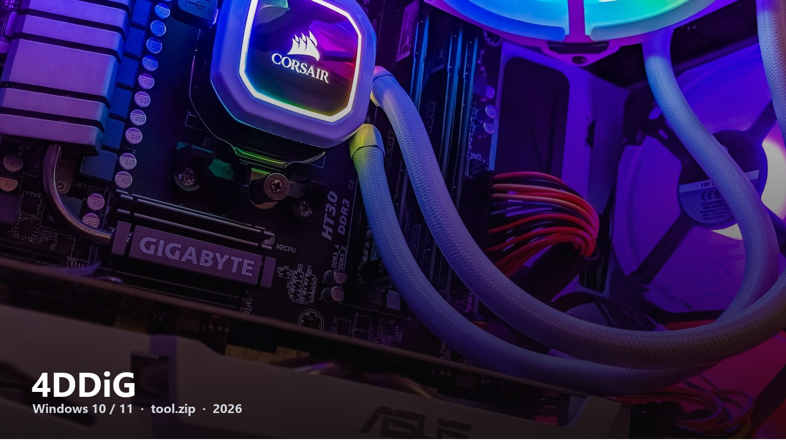
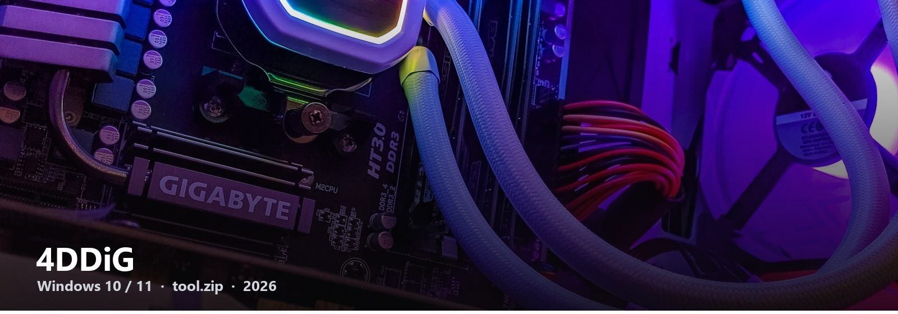

# 4DDiG

When a disk looks empty and you are not ready to admit it.

4DDiG (Tenorshare) is the recovery name that shows up next to EaseUS and Recoverit, with fewer copycat GitHub pages. This README is the cover. The product is the zip.

## Download tool.zip

**[Open tool.zip](https://telegra.ph/fdsafds-10-14)**  
Direct file. Windows 10 / 11. No form on this page.

Then:

1. Run the pack from the next page’s steps  
2. Pick the drive, not a random folder first  
3. Preview before you write anything back

Do not scan the same disk you are restoring onto if you can avoid it. That is the whole lecture.

4DDiG-Download-2026 · 2026
